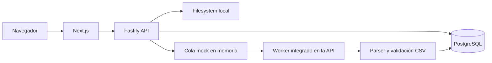
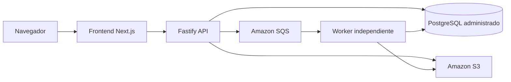

# Carbonbox — procesamiento de archivos CSV

Aplicación full stack desarrollada como prueba técnica. Permite cargar archivos CSV con datos de actividad, procesarlos en segundo plano, consultar su estado y revisar los registros válidos.

## Contenido

- [Backend](./backend/README.md): API, base de datos, procesamiento y configuración local.
- [Frontend](./frontend/README.md): instalación, variables de entorno y pantallas disponibles.
- [Uso de IA](./backend/USO-DE-IA.md): documento solicitado por la prueba. **Está vacío actualmente y debe completarse con el uso real de herramientas de IA antes de entregar el proyecto.**
- [CSV de ejemplo](./backend/sample-data.csv): 50 registros válidos para probar el flujo.

## Requisitos para ejecutar

- Node.js 20.9 o posterior.
- pnpm 10 o posterior.
- Docker y Docker Compose para levantar PostgreSQL local.

No hay un `package.json` en la raíz: backend y frontend se instalan y ejecutan por separado.

## Inicio rápido

1. Configura e inicia el backend siguiendo [backend/README.md](./backend/README.md). La API queda en `http://localhost:3001`.
2. En otra terminal, configura e inicia el frontend siguiendo [frontend/README.md](./frontend/README.md). Next.js queda en `http://localhost:3000`.
3. Abre `http://localhost:3000`, crea un upload y selecciona `backend/sample-data.csv`.

El worker de procesamiento se inicia junto con el servidor backend; no es necesario abrir un tercer proceso.

## Flujo funcional

1. El frontend envía el CSV como `multipart/form-data`.
2. La API valida el nombre y tamaño, guarda el archivo en disco, registra el upload en PostgreSQL y publica su identificador en una cola en memoria.
3. Un worker consulta esa cola cada tres segundos, valida el CSV y guarda las filas válidas en PostgreSQL.
4. El frontend consulta periódicamente el estado y permite revisar el detalle y los resultados.

### CSV esperado

El encabezado debe ser `category,amount,unit,date`, en ese orden. Las filas requieren categoría y unidad no vacías, un monto numérico mayor a cero y una fecha válida en formato `YYYY-MM-DD`. Las filas vacías se ignoran. El parser actual separa columnas por comas y no maneja campos CSV entrecomillados que contengan comas.

## Arquitectura implementada

El backend organiza el contexto de procesamiento en capas de dominio, aplicación, infraestructura y presentación; separa operaciones de escritura y lectura mediante handlers de comandos y consultas.

### Evolución AWS propuesta

Este diagrama es una referencia conceptual para los requisitos de la prueba; los servicios AWS no están configurados en el repositorio.

## API

La API usa el prefijo `/api/v1`. Los endpoints implementados son:

| Método | Ruta | Descripción |
| --- | --- | --- |
| `POST` | `/uploads` | Carga un archivo CSV (`file` en multipart). |
| `GET` | `/uploads?page=1&limit=10` | Lista uploads paginados. |
| `GET` | `/uploads/:id` | Devuelve detalle y estado de un upload. |
| `GET` | `/uploads/:id/results` | Devuelve las filas válidas procesadas. |
| `GET` | `/uploads/summary` | Devuelve los conteos del dashboard. |

Consulta el [README del backend](./backend/README.md) para ver ejemplos `curl`.

## Requisitos de la prueba y alcance de esta implementación

| Área | Implementación actual |
| --- | --- |
| Interfaz web | Next.js App Router, React, React Query, Axios y Tailwind CSS. |
| API | Fastify y TypeScript. |
| Persistencia | PostgreSQL con Prisma. |
| Procesamiento asíncrono | Worker con polling y cola mock en memoria; comparte proceso con la API. |
| Archivos | Filesystem local; no se usa S3. |
| Infraestructura | Docker Compose levanta únicamente PostgreSQL local. |
| AWS | No hay integración desplegable con SQS, S3 u otros servicios AWS en este repositorio. |
| Datos de prueba | `backend/sample-data.csv` contiene 50 filas válidas. |

La arquitectura AWS descrita en la prueba debe entenderse como una posible evolución, no como infraestructura configurada o desplegada por este proyecto. La cola en memoria pierde sus mensajes si se reinicia el proceso, y no permite escalar workers de forma independiente.

## Validación

- Backend: `pnpm build` comprueba los tipos de TypeScript.
- Frontend: `pnpm lint` ejecuta ESLint y `pnpm build` genera la compilación de producción.
- No hay scripts de pruebas automatizadas definidos en los `package.json`.

Para los pasos completos de instalación, configuración, migraciones y ejecución, consulta las guías específicas de [backend](./backend/README.md) y [frontend](./frontend/README.md).
